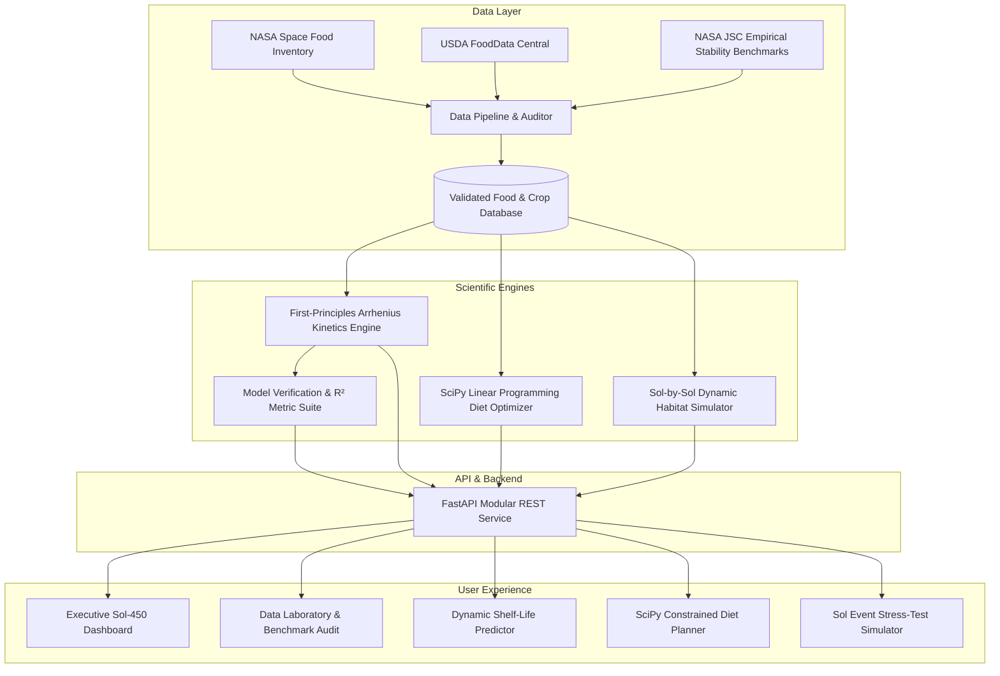

# NurtureAI — Autonomous Space Nutrition & Life Support Technical Architecture

> Organization: `NurtureAI`  
> Author: Team NurtureAI (Suleyman Hajizadeh, Banu Gurbanizada, Yunis, Faruk)

---

## 1. System Overview

**Mars Food Intelligence** is an autonomous mission-critical food system designed for long-duration surface missions on Mars (Sol-0 to Sol-1000+). Rather than treating space nutrition as static inventory, the system models the biophysical, kinetic, and thermodynamic reality of deep-space storage, bio-regenerative agriculture (BLSS), and thermal life-support system interactions.

---

## 2. Scientific & Biophysical Formulations

### 2.1 First-Order Arrhenius Degradation Kinetics
Nutrient loss (specifically heat-sensitive Thiamine B1 and Ascorbic Acid / Vitamin C) is computed using first-order reaction kinetics:

$$\frac{d[C]}{dt} = -k(T) \cdot [C]$$

Integrating with respect to time under variable temperature profile $T(t)$:

$$[C](t) = [C]_0 \cdot \exp\left(-\int_0^t k(T(\tau)) \, d\tau\right)$$

The reaction velocity constant $k(T)$ is modeled via the Arrhenius equation:

$$k(T) = A \cdot \exp\left(-\frac{E_a}{R \cdot T}\right)$$

Where:
- $A$: Pre-exponential collision frequency factor ($\text{day}^{-1}$)
- $E_a$: Activation energy ($\text{J}\cdot\text{mol}^{-1}$)
- $R$: Universal gas constant ($8.314 \, \text{J}\cdot\text{mol}^{-1}\cdot\text{K}^{-1}$)
- $T$: Absolute temperature in Kelvin ($T_K = T_{^\circ\text{C}} + 273.15$)

### 2.2 Half-Life ($t_{1/2}$) and Drop-Dead Sol Determination
The time required for 50% degradation of a critical micronutrient:

$$t_{1/2} = \frac{\ln(2)}{k(T)}$$

The **Drop-Dead Sol** is defined as the exact mission Sol where nutrient concentration drops below the NASA-STD-3001 threshold:

$$\text{Drop-Dead Sol} = \min \{ \text{Sol} \mid [C](\text{Sol}) < [C]_{\text{threshold}} \}$$

### 2.3 SciPy Multi-Objective Constrained Linear Optimization
The optimal daily meal composition $x \in \mathbb{R}^N$ ($x_i =$ servings of item $i$) is computed using `scipy.optimize.linprog` with the HiGHS solver:

$$\min_{x} c^T x$$

Subject to NASA-STD-3001 dietary constraints:

$$A_{\text{ub}} x \ge b_{\text{ub}} \iff -A_{\text{ub}} x \le -b_{\text{ub}}$$

1. **Caloric Minimum**:
   $$\sum_{i=1}^N \text{Calories}_i \cdot x_i \ge 2800 \times \text{CrewSize}$$
2. **Protein Minimum (Muscle Atrophy Prevention)**:
   $$\sum_{i=1}^N \text{Protein}_i \cdot x_i \ge 85 \times \text{CrewSize}$$
3. **Vitamin C Minimum (Oxidative Stress & Immune Countermeasure)**:
   $$\sum_{i=1}^N \text{VitC}_i(t) \cdot x_i \ge 90 \times \text{CrewSize}$$
4. **Thiamine B1 Minimum (Cognitive & Neurological Defense)**:
   $$\sum_{i=1}^N \text{Thiamine}_i(t) \cdot x_i \ge 1.2 \times \text{CrewSize}$$
5. **Rehydration Water Cap**:
   $$\sum_{i=1}^N \text{WaterRehydrate}_i \cdot x_i \le \text{MaxWaterDaily}$$
6. **Fresh Biomass Availability**:
   $$\sum_{i \in \text{Fresh}} \text{ServingMass}_i \cdot x_i \le \text{FreshBiomassYield}_{\text{Sol}}$$

---

## 3. Modular Architecture

### 3.1 Backend (`/backend`)
- **`app/core/constants.py`**: NASA-STD-3001 dietary references, thermal regimes, physical constants.
- **`app/core/scientific_models.py`**: Numerical integration of Arrhenius equations, Q10 acceleration factors, and composite viability scoring.
- **`app/data/`**: Space food catalog with verified mass, nutritional content, and Arrhenius activation parameters; NASA JSC experimental validation benchmarks.
- **`app/pipeline/`**: Pydantic schema validation, unit auditing, physiological bounds enforcement.
- **`app/services/`**:
  - `prediction_service.py`: Shelf-life calculation, thermal excursion modeling, and NASA benchmark calibration.
  - `optimization_service.py`: SciPy linear programming solver.
  - `simulator_service.py`: Sol-by-Sol habitat simulation engine with failure injections.
- **`app/api/`**: RESTful endpoints documented via OpenAPI/Swagger.

### 3.2 Frontend (`/frontend`)
- **React 18 + TypeScript + Tailwind CSS + Lucide Icons**.
- **Interactive SVG Vector Graphing**: High-precision rendering of exponential degradation curves, dynamic milestone markers, and mission stress-test bands.
- **5 Core Application Views**:
  1. *Mission Dashboard*: Sol timeline scrubber, food security gauge, ration count, cooling power.
  2. *Data Laboratory*: Catalog inspector, 100% audit integrity, empirical NASA JSC benchmark comparison ($R^2 \ge 0.99$).
  3. *Prediction & Kinetics*: Temperature sliders, Arrhenius parameter inspection, drop-dead Sol detection.
  4. *SciPy Optimizer*: Linear programming solver for daily astronaut meal plans.
  5. *Mission Simulator*: Sol event failure injections (cooling failure, crop blight), survival verdicts, and real-time hazard logs.

---

## 4. Verification & Testing Standards

- **Unit & Integration Suite**: 11 automated Pytest tests verifying kinetic temperature sensitivity, first-order decay, $R^2$ benchmark accuracy, linear optimizer convergence, and API endpoints.
- **Continuous Integration**: GitHub Actions CI workflow running on every commit.
- **Zero-Error Frontend Build**: Vite + TypeScript compiled with strict checks.
